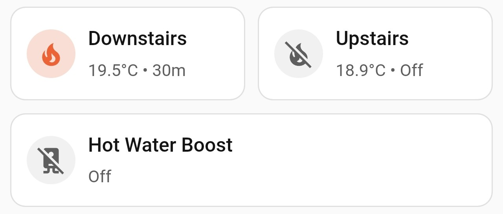
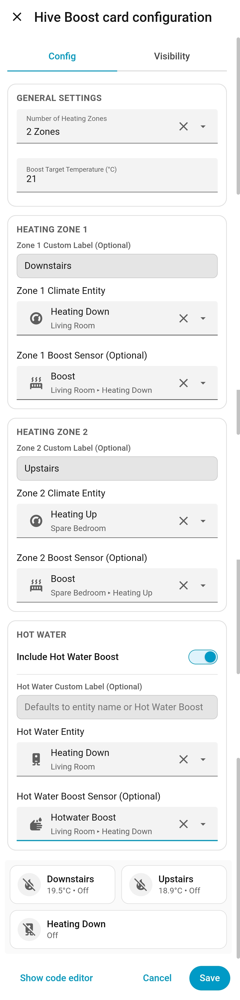

# Hive Boost Card for Home Assistant

A clean, interactive custom Lovelace card for Home Assistant that lets you cycle through Hive heating and hot water boost durations with a single tap, display live room temperatures, and cancel active boosts with a press-and-hold.



## Features

- **Flexible Zone Support (0 to 4 Zones):** Choose anywhere from `0` to `4` independent heating zones during setup, plus an optional toggle for **Hot Water Boost**.
- **Single-Tap Duration Cycling:** Tap any button to cycle through `30m` → `1h` → `1.5h` → `2h` → `Off`.
- **Smart 1.5-Second API Debounce:** Rapid taps cycle the UI instantly and queue your final selection for **1.5 seconds** before sending a single command to Hive—preventing you from hitting Hive's cloud API rate limits when tapping through to longer durations.
- **Instant Press & Hold to Cancel:** Hold any button for ~0.65 seconds to bypass the debounce and immediately cancel an active boost (including boosts started externally from the Hive app or physical thermostat).
- **Live Room Temperatures:** Displays the current room temperature directly alongside the active boost stage for each heating zone.
- **External Boost Sync:** Automatically highlights buttons in deep orange and shows `Active` when a boost is triggered outside Home Assistant.
- **Grouped Visual Editor:** Pick your zone count, custom labels, Hive `climate` zones, `water_heater` entity, boost `binary_sensor` entities, and target boost temperature using native dropdown menus—no YAML required.

---

## Installation

### Option 1: HACS (Recommended)

1. Open **HACS** in your Home Assistant instance.
2. Go to **Frontend** (or **Dashboard**).
3. Click the **three dots** in the top right corner and select **Custom repositories**.
4. Paste the URL of this GitHub repository, select **Dashboard** (or **Lovelace**) as the category, and click **Add**.
5. Find **Hive Boost Card** in HACS and click **Download**.
6. Refresh your browser when prompted.

### Option 2: Manual Installation

1. Download `hive-boost-card.js` from the latest release.
2. Copy `hive-boost-card.js` into your Home Assistant `/config/www/` directory.
3. Go to **Settings** > **Dashboards** > **three dots** (top right) > **Resources**.
4. Click **Add Resource**, enter `/local/hive-boost-card.js` as the URL, select **JavaScript Module**, and click **Create**.
5. Refresh your browser.

---

## Setup & Configuration

1. Open any dashboard and click **Edit Dashboard** (pencil icon).
2. Click **Add Card** and search for **Hive Boost Card**.
3. Use the visual onboarding editor to configure your setup:
   - **General Settings:** Select the **Number of Heating Zones** (`0` to `4`) and set your **Boost Target Temperature (°C)** (default: `21.0`).
   - **Heating Zones (1–4):** Enter an optional custom label (or leave blank to automatically use the entity's friendly name), select your Hive `climate` entity, and optionally link its boost `binary_sensor` for external sync and auto-reset.
   - **Hot Water:** Toggle **Include Hot Water Boost** on or off, set an optional custom label, select your Hive `water_heater` entity, and optionally link its boost `binary_sensor`.
4. Click **Save**.



### Example YAML Configuration

If you prefer configuring cards via YAML, here is an example 2-zone setup with hot water:

```yaml
type: custom:hive-boost-card
zone_count: 2
temperature: 21
zone_1_name: Downstairs
zone_1_climate: climate.heating_down
zone_1_sensor: binary_sensor.heating_down_boost
zone_2_name: Upstairs
zone_2_climate: climate.heating_up
zone_2_sensor: binary_sensor.heating_up_boost
include_water: true
water_name: Hot Water Boost
water_entity: water_heater.heating_down
water_sensor: binary_sensor.hotwater_boost
```

---

## Controls

| Action | Behavior |
| :--- | :--- |
| **Single Tap** | Advances boost duration (`30m` → `1h` → `1.5h` → `2h` → `Off`) and sends the command after a **1.5-second debounce** so rapid taps don't trigger Hive API rate limits |
| **Press & Hold** | Immediately cancels any pending debounce or active internal/external boost and resets to `Off` |

---

## Credits & Notes

Built and tested on a multi-zone Hive setup with AI coding assistance. Feel free to open an issue on GitHub if you spot a bug or have a suggestion!
