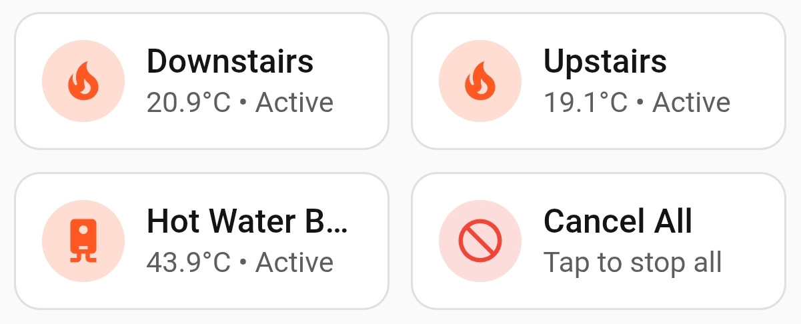
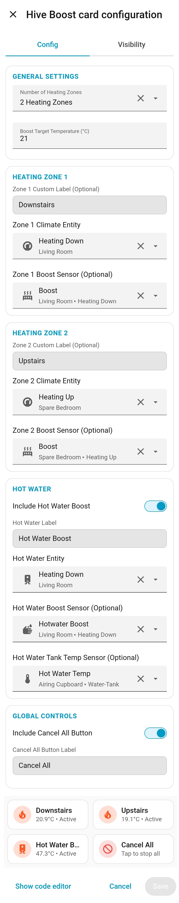

# Hive Boost Card for Home Assistant

A clean, standalone custom Lovelace card for Home Assistant that lets you cycle through Hive heating and hot water boost durations with a single tap, view live room temperatures and remaining boost countdowns, and cancel active boosts individually or all at once.



## Features

- **Single-Tap Duration Cycling:** Tap any button to cycle through `30m` → `1h` → `1.5h` → `2h` → `Off`.
- **Live Boost Countdown:** Displays the remaining boost time in real time (e.g., `18.6°C • 42m left` or `1h 15m left`), syncing with Hive sensor attributes as well as internal timers.
- **Cancel All Boosts Button:** Optional one-tap **Cancel All** button on the bottom row alongside Hot Water Boost to stop every active heating and hot water boost simultaneously.
- **1.5-Second API Debounce:** Waits 1.5 seconds after your last tap before sending the boost command to Hive. This prevents hitting Hive's cloud API rate limits when tapping quickly through longer boost durations while keeping UI feedback instant.
- **Press & Hold to Cancel:** Hold any individual button for ~0.65 seconds to immediately cancel that zone's boost (including boosts started externally from the Hive app or physical thermostat).
- **Live Room Temperatures & External Sync:** Displays current room temperatures and automatically highlights buttons in deep orange when a boost is running outside Home Assistant.
- **Built-In Visual Editor:** Configure `0`–`4` heating zones, toggle Hot Water Boost, toggle Cancel All, and pick your Hive entities using grouped native dropdown menus—no YAML or extra cards required.

---

## Installation

### Option 1: HACS (Recommended)

1. Open **HACS** in your Home Assistant instance.
2. Go to **Frontend** (or **Dashboard**).
3. Click the **three dots** in the top right corner and select **Custom repositories**.
4. Paste the URL of this GitHub repository, select **Dashboard** (or **Lovelace**) as the category, and click **Add**.
5. Find **Hive Boost Card** in HACS and click **Download**.
6. Refresh your browser when prompted.

### Option 2: Manual Installation

1. Download `hive-boost-card.js` from the latest release.
2. Copy `hive-boost-card.js` into your Home Assistant `/config/www/` directory.
3. Go to **Settings** > **Dashboards** > **three dots** (top right) > **Resources**.
4. Click **Add Resource**, enter `/local/hive-boost-card.js` as the URL, select **JavaScript Module**, and click **Create**.
5. Refresh your browser.

---

## Setup & Configuration

1. Open any dashboard and click **Edit Dashboard** (pencil icon).
2. Click **Add Card** and search for **Hive Boost Card**.
3. Use the grouped visual editor to configure your setup:
   - **General Settings:** Choose the **Number of Heating Zones** (`0` to `4`) and set your **Boost Target Temperature (°C)** (default: `21.0`).
   - **Heating Zones (1–4):** Enter an optional custom label (or leave blank to use the entity's friendly name), select your Hive `climate` entity, and optionally link its boost `binary_sensor` for live countdown syncing and external boost detection.
   - **Hot Water & Actions:** Toggle **Include Hot Water Boost** on or off, pick your Hive `water_heater` entity and boost `binary_sensor`, and toggle the **Include Cancel All Button** on or off.
4. Click **Save**.



### Example YAML Configuration

If you prefer configuring cards via YAML, here is an example 2-zone setup with Hot Water and Cancel All enabled:

```yaml
type: custom:hive-boost-card
zone_count: 2
temperature: 21
zone_1_name: Downstairs
zone_1_climate: climate.heating_down
zone_1_sensor: binary_sensor.heating_down_boost
zone_2_name: Upstairs
zone_2_climate: climate.heating_up
zone_2_sensor: binary_sensor.heating_up_boost
include_water: true
water_name: Hot Water Boost
water_entity: water_heater.heating_down
water_sensor: binary_sensor.hotwater_boost
include_cancel_all: true
cancel_all_name: Cancel All
```

---

## Controls

| Action | Behavior |
| :--- | :--- |
| **Single Tap** | Cycles boost duration (`30m` → `1h` → `1.5h` → `2h` → `Off`) and sends the request after a **1.5-second pause** |
| **Press & Hold** | Immediately cancels that zone's active internal or external boost with zero delay |
| **Tap Cancel All** | Immediately stops all active heating and hot water boosts across every configured zone |

---

## Credits & Notes

Built and tested on a multi-zone Hive setup with AI coding assistance. Feel free to open an issue on GitHub if you spot a bug or have a suggestion!
